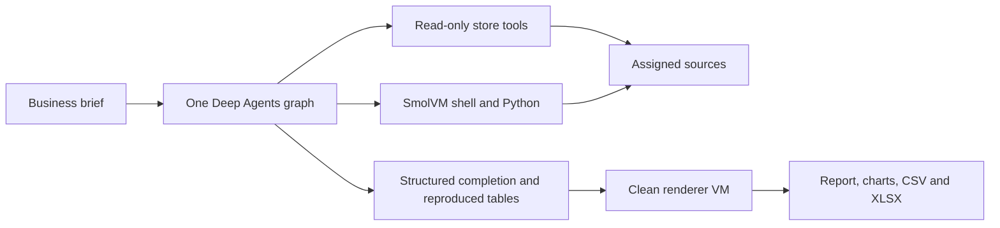

# BackIntel

**Business analysis from assigned data, with executable evidence and useful deliverables.**

BackIntel is an experimental data-analyst agent built with the LangChain Deep Agents SDK.
It discovers schemas, queries read-only sources, runs Python in SmolVM, and produces
structured answers or reports with charts, CSV tables and Excel workbooks. It is designed
for developers and analysts building reproducible business and operational analysis.

**Status: v0.0.1, experimental.** Use a source checkout. This is not a supported production
service or an unattended 24/7 analyst. The historical `codex/backintel-v2` branch name is
not a product version. Code is available under the [MIT license](LICENSE).

[Get started](#get-started) · [Capabilities](#capabilities-today) ·
[Architecture](#how-it-works) · [Evaluation](#what-has-been-measured) ·
[Roadmap](docs/roadmap.md) · [Contributing](#contributing)

## Capabilities today

| Area | Implemented behavior | Current boundary |
| --- | --- | --- |
| Business analysis | Filters, aggregates, joins, rankings, weighted metrics, time-window calculations and explicit missing-data refusals | Evaluated on bounded historical and synthetic tasks; arbitrary-domain accuracy is not established |
| Data engineering | Schema discovery, bounded profiling, read-only source queries and transformations inside a run | No production ETL orchestration, source writes or customer connector service |
| Data science | Descriptive analysis and executable calculation checks using Python/SQL | Forecasting, causal inference and trained predictive workflows are not validated capabilities |
| Reporting | HTML reports; bar, line, scatter, histogram and heatmap charts; PNG/SVG; offline interactive HTML; CSV and XLSX | Local file bundles with bounded tables; no hosted dashboard or automated delivery service |
| Repeated analysis | Standing questions and historical snapshot replays that hide future observations | Replayed invocations, not a durable scheduler |
| Improvement | Versioned cases, reproducible evidence, LangSmith traces/scores and supervised candidate comparisons | No automatic weight training, deployment or self-promotion |

Two entry points share the same source boundaries:

- **`ask`** runs the benchmark analyst and returns a structured answer with evidence, method
  and caveats. Its default is `openrouter/openai/gpt-6-luna`.
- **`analyze`** runs an opt-in coding specialist with a persistent per-run workspace and
  artifact export. Its default is `chatgpt-plan/gpt-6.1-sol` with medium reasoning.

Each entry point runs one Deep Agents graph. The analyst does not automatically delegate
to the specialist, and runtime sub-agents are disabled.

### Data sources

| Store | Native access | Evidence and limits |
| --- | --- | --- |
| SQLite | SQL over a local database | Historical benchmark runs and the controlled specialist tasks |
| PostgreSQL | Native read-only SQL | Historical single-store and PostgreSQL/SQLite cross-store runs |
| FerretDB | MongoDB-compatible aggregation through PyMongo | Tested against FerretDB; this does not qualify arbitrary MongoDB deployments. Its benchmark backend is frozen to enforce read-only access |
| DuckDB / Parquet | SQL over local Parquet | Historical benchmark and generated TPC-H SF1 workloads |
| Iceberg / object storage | DuckDB over Iceberg metadata and Parquet on Garage S3 | Historical native-store benchmark; not every S3 provider or Iceberg deployment |
| ClickHouse | Native read-only SQL | Historical native-store benchmark |
| CSV and mixed CSV/JSON | Bounded file discovery and Python | CSV benchmark plus a small mixed-format probe; universal folder ingestion is planned |
| Multiple stores | Explicitly assigned store combinations | Six historical PostgreSQL/SQLite cases |
| Vector databases | Not implemented | Optional document retrieval is roadmap work |

A connector's existence is distinct from a successful model evaluation. These data sources
have been used for testing; BackIntel has not trained or fine-tuned its models on them.

## Get started

### Requirements

- Python **3.12** and [uv](https://docs.astral.sh/uv/). Package metadata also permits Python
  3.13; 3.12 is the documented, CI-tested path.
- **macOS on Apple Silicon** for the qualified SmolVM execution path. Linux and Windows
  runtime support has not been qualified. Python-only CI runs on Linux.
- Docker for the initial sandbox image build/export and optional database services.
  Prepared SQLite/file analysis runs in SmolVM without Docker execution.
- For live analysis, an authorized ChatGPT subscription connection or a configured
  supported OpenRouter model. No model account is needed for the offline checks below.

### 1. Check out and verify the project

Until a versioned release is published, use a source checkout of `main`:

```bash
git clone https://github.com/IntelIP/BackIntel.git
cd BackIntel
uv sync --frozen --python 3.12
uv run backintel --help
uv run pytest -q
```

The standard tests make no model-provider calls. Optional rendering, VM and live-service
checks are skipped when their dependencies or opt-in flags are absent.

Prepare the controlled development fixtures without inference or source downloads:

```bash
uv run backintel acceptance build --split development
```

Expected result: a manifest for **17 development cases** with data and reference hashes.
This prepares an evaluation dataset; it does not demonstrate agent performance.

### 2. Prepare SmolVM

```bash
docker build -f Dockerfile.sandbox -t backintel-sandbox:py312 .
uv run python -m scripts.prepare_smolvm
uv run backintel sandbox check
```

Preparation pins the SmolVM distribution and exported image. The check runs Python in a
VM and should report a successful exit with public networking blocked. See
[sandbox setup, packages and resource profiles](docs/sandbox-environment.md).

### 3. Generate a report

Download and build the historical Online Retail II test source, then connect your own
ChatGPT account and run the supplied example brief:

```bash
uv run backintel data build online_retail_ii
uv run backintel chatgpt login
uv run backintel chatgpt models
uv run backintel analyze \
  --store sqlite:online_retail_ii \
  --brief examples/retail-brief.json \
  --output data/output/retail-report \
  --max-model-calls 24 --max-tool-calls 50 --timeout 900
```

Confirm that the account's model catalog includes `gpt-6.1-sol`. `analyze` also accepts
`--model` and `--reasoning` overrides. Source acquisition may use the network; the analytical
VM cannot browse the internet or install packages. Reuse `chatgpt status` for an existing
connection rather than starting another login.

A successful run writes:

```text
data/output/retail-report/
├── run.json                  # completion, transcript, usage and runtime identity
└── artifacts/report/
    ├── report.html           # findings, tables, evidence and caveats
    ├── report.json           # retained report specification
    ├── supporting.xlsx
    ├── tables/*.csv
    ├── charts/*.{html,png,svg}
    └── manifest.json         # delivered-file inventory and hashes
```

Use a **new output directory** for every run. A valid refusal explains the missing inputs;
it does not export a substitute report. A failed or unfinished analysis is not a successful
delivery. The example's figures are computed from the downloaded source, not hardcoded.

### Configuration and credentials

BackIntel reads environment variables; it does not load `.env` files. Supply credentials
through your secret manager or shell environment. IntelIP development uses Doppler, but
access to IntelIP's Doppler project is **not required** by the application.

| Setting | Purpose |
| --- | --- |
| `BACKINTEL_ANALYSIS_MODEL` | Override the specialist default; explicit `--model` takes precedence |
| `BACKINTEL_MODEL` | Benchmark analyst model |
| `BACKINTEL_JUDGE_MODEL` | Method judge; default `openrouter/anthropic/claude-haiku-5.5` |
| `OPENROUTER_API_KEY` | Required when using the OpenRouter route |
| `LANGSMITH_API_KEY`, `LANGSMITH_PROJECT`, `LANGSMITH_TRACING` | Optional tracing and experiment configuration |
| `BACKINTEL_DATA_DIR` | Data directory; defaults to the checkout's `data/` |
| `BACKINTEL_SANDBOX` | `smolvm`; other execution backends are rejected |

ChatGPT credentials stay in BackIntel's private local account cache, outside the source tree
and VM mounts. Subscription usage reports calls and tokens; it does not provide a
per-request API dollar charge. There is no paid-API fallback. An OpenRouter specialist run
requires both `--max-cost-usd` and `--reservation-usd`; these are application admission
limits, not a provider-enforced billing cap. See [model selection and usage](docs/specialist-default.md).

Olist acquisition additionally needs your own Kaggle access. Dataset permissions are
separate from this repository's code license; see the [benchmark specification](docs/benchmark.md).

## How it works



The host supplies business context, source access, model choice and limits. Store tools
execute native bounded reads. Generated shell/Python code runs inside a per-run VM with
read-only sources, bounded writable directories and no public network. Assigned database
services use restricted endpoints. Model inference and optional LangSmith uploads occur
on the host, outside the VM; the model receives the brief and tool results.

For reports, the host retains the specification and re-executes cited calculations to
reconcile its tables. Valid structured completion is required before a separate clean VM
renders the delivered files. One prose-only stop can receive a recovery prompt within the
original limits; it is never silently converted into success.

The standard specialist profile uses **2 CPUs and 2 GiB RAM**, with separate workspace,
artifact and temporary-file quotas. A larger profile exists, but is not evidence of real
large-data reliability. Aggregate capacity reservation across concurrent runs is not implemented.

### Prompts, skills and tools

- System prompts: [benchmark analyst](src/backintel/agent_files/lead.md) and
  [analysis specialist](src/backintel/agent_files/analysis.md).
- Runtime skills: [analytical methods and source-specific guidance](src/backintel/agent_files/skills).
  The coding assistant's installed skills are not automatically available inside BackIntel.
- Store tools: `list_tables`, `describe_table`, `run_sql` / `run_query` and `run_python`.
- Specialist tools additionally include `run_shell`, `write_analysis_file`,
  `read_analysis_file`, `render_report` and `inspect_chart`.
- Virtual documentation tools: `ls`, `read_file`, `glob` and `grep`. Virtual `/skills/`
  paths are distinct from the VM filesystem; use `read_file` to read them.
- Output contract: [artifact specification](src/backintel/agent_files/docs/artifact-contract.md).

The agent may revise its programs and reports inside a run. It cannot change its governing
prompt, model weights, permissions or release; write to source databases; browse for extra
facts; or deploy itself. Installed scientific libraries do not establish validated forecasting
or causal-analysis capabilities.

## What has been measured

These are versioned development observations, not a production accuracy guarantee.

| Experiment | Observed result | Scope |
| --- | --- | --- |
| Historical Olist storage matrix | 143/144 supported responses | GPT-6 Luna; 24 questions repeated across six stores on the earlier runtime |
| Historical UCI storage runs | 80/80 | 20 questions on four stores; repetitions are not independent domains |
| Historical standing reports and replay | 15/17 | Three standing reports plus 14 historical replay cases; no live scheduler |
| Historical TPC-H SF1 | 6/6 | Generated analytical workload; not real 10 GiB data or an official performance result |
| Controlled Sol specialist on SmolVM | 3/4 | Retail refunds, missing-cost refusal, energy coverage and service availability; one trial each |
| Energy after completion recovery fix | 1/1 | Targeted rerun delivered the correct report, heatmap, CSVs and workbook; other cases were not rerun on that candidate |

The specialist cases use **three small synthetic SQLite fixtures**, with sales reused for
the missing-cost question. The energy failure had correct intermediate numbers but no
structured completion or exported bundle. The fix's live rerun completed directly without
needing recovery; a deterministic SmolVM regression separately exercised recovery and export.
The 3/4 baseline remains unchanged: a targeted success is not a new 4/4 experiment.

Historical results and failures are in the [capability report](docs/results.md) and
[scorecard](results/scorecard.md). The [SmolVM baseline](https://smith.langchain.com/o/90b24546-f3e2-4f48-af72-b06e73b27b49/datasets/d2e934c2-77e8-4926-93b3-0bcd644b200d/compare?selectedSessions=f667f6fc-4e8d-4bba-bcbf-fcde7d808d40)
and [energy rerun](https://smith.langchain.com/o/90b24546-f3e2-4f48-af72-b06e73b27b49/datasets/d2e934c2-77e8-4926-93b3-0bcd644b200d/compare?selectedSessions=ff29645c-8e96-4cd8-875c-302ae006acf8)
are separate LangSmith experiments; workspace access may be required. The
[four-case suite](evals/analysis/cases.md) includes fixture builders, independent references,
wrong-answer controls and a runnable comparison harness.

After preparing SmolVM, verify all four cases with scripted decisions and no model calls:

```bash
uv run python -m scripts.run_analysis_comparison
```

This exercises the actual graph, sandbox and artifact delivery; it is integration evidence,
not a live quality score. To prepare only the fixtures without starting a VM:

```bash
uv run python -m scripts.analysis_cases data/output/my-new-analysis-fixtures
```

Use a new output directory for every run. The [evaluation guide](docs/analysis-sandbox.md)
documents the subscription and explicitly budgeted API modes. Live comparisons require
explicit model IDs, retain failed attempts and never promote a model automatically.

### Evaluation and data quality

The original suite covers seven levels: single-table analysis, joins, messy/unanswerable
data, cross-store queries, standing reports, historical replay and generated scale.
Independent code computes numerical references. Evidence is re-executed; a separate model
judge evaluates method and caveats where configured. LangSmith stores experiments, traces
and feedback—it does not automatically fine-tune the model.

The 34 additional controlled acceptance cases comprise **17 development and 17 reserved
variants**. Fixture readiness is not a passing model result. References, solutions and
reserved truth stay outside the analyst's accessible data. Source hashes and frozen
baseline/candidate comparisons preserve provenance; failures are retained.

Data coverage includes historical [Online Retail II](https://archive.ics.uci.edu/dataset/502/online+retail+ii),
[Olist](https://www.kaggle.com/datasets/olistbr/brazilian-ecommerce), generated TPC-H and the
controlled fixtures. Public data may have appeared in model pretraining; the benchmark does
not establish training-data novelty. Read the [data-quality assessment](docs/data-quality.md),
[acceptance specification](docs/acceptance-spec.md) and [improvement workflow](docs/improvement-loop.md).
Method-judge scores have not been calibrated against human labels.

## Roadmap

These are acceptance milestones, not shipped versions or promised dates. Some later-stage
components already exist; a milestone closes only when its evaluation and delivery criteria pass.

| Target | Capability to establish |
| --- | --- |
| **v0.0.1** | Reproducible foundation, reliable completion/refusal, executable evidence and a frozen baseline/candidate comparison |
| **v0.0.2** | Drop-in analysis across three unfamiliar domains, with one entire domain reserved from tuning |
| **v0.0.3** | Real large-data analysis at staged sizes up to at least 10 GiB on a qualified host |
| **v0.0.4** | Consistent, verified report/chart/workbook delivery across the acceptance suite |
| **v0.0.5** | Reusable business metrics and decision-report packs |
| **v0.1.0** | One controlled customer pilot with an explicit data and workload contract |
| **v0.2.0** | Durable scheduled jobs, cancellation, bounded retries and recovery |
| **v0.3.0** | Qualified operational connectors, change detection and deduplicated alerts |
| **v0.4.0** | Evaluated document context and statistical/forecasting workflows |
| **v0.5.0** | Managed background-analysis beta with user controls, history and spending limits |
| **v0.9.0 → v1.0.0** | Operational hardening, reversible releases and a supported, bounded service |

The [detailed roadmap](docs/roadmap.md) gives the next implementable tasks, dependencies and
completion criteria. Linear remains the internal delivery tracker; the public plan is readable
without access to it. No production hosting or continuous background operation is available today.

## Contributing

Start with the [roadmap](docs/roadmap.md), [benchmark specification](docs/benchmark.md) and
[repository instructions](AGENTS.md). Propose a bounded capability or reproduce a concrete
failure before changing models, infrastructure or evaluation criteria.

```bash
uv run ruff check src tests scripts
uv run ruff format --check src tests scripts
uv run vulture src --min-confidence 100
uv run pytest -q
# Optional: prepared macOS ARM64 SmolVM runtime required; no model calls
BACKINTEL_SMOLVM_TESTS=1 uv run pytest tests/test_analysis_completion.py -q
```

Keep changes focused, add a regression for non-trivial behavior, and explain what changed,
what was measured and what remains unsupported. Preserve frozen benchmark truth and earlier
failed attempts. Do not commit credentials, account caches, downloaded datasets or raw traces.
Hosted CI checks Python, formatting, dead code and secrets; it does not run live model experiments.

Report reproducible bugs and proposals through [GitHub Issues](https://github.com/IntelIP/BackIntel/issues).
Include the source revision, platform, command and sanitized failure details. Keep private
data and credentials out of public reports. Model runs, infrastructure changes and publication
require the applicable project authorization.

## License

BackIntel's code is [MIT licensed](LICENSE), copyright IntelIP. Dataset and model/provider
terms are separate; the repository's license does not relicense third-party data or services.
