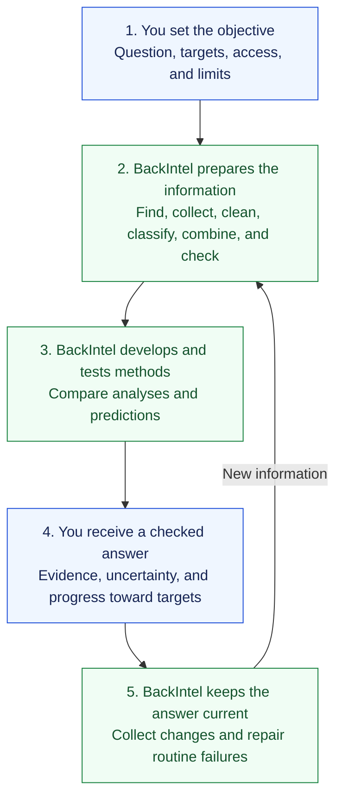
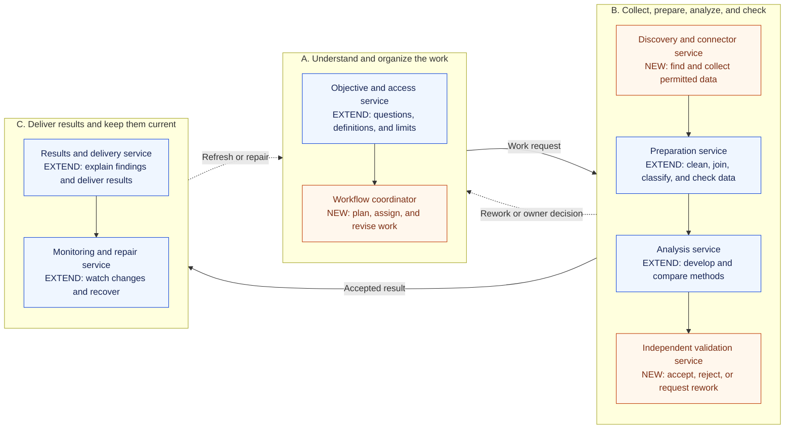

# BackIntel system design

Updated October 14, 2026. Current-source observations refer to `3cd9991`; this planning update changes no product behavior and reruns no historical application acceptance campaign.

## Intended user experience

A business owner states an objective and business measures, connects permitted systems, and sets operating limits. BackIntel works out the data and methods needed, builds and checks the pipeline, returns an explained answer, and maintains it as the information changes. The owner resolves material business ambiguity or access decisions rather than configuring every routine step.

Databricks is the reference example, not a connection already implemented or a deployment selected by this document. **Illustrative question:** “Which products are likely to miss their weekly sales targets, and what evidence explains the risk?” The actual first question, data, and targets still need selection.

For that example, the intended system would inspect the permitted catalog and source documentation, identify sales, product, and target data, resolve relevant business definitions, create extraction and preparation steps, reconcile records and totals, develop and evaluate an appropriate prediction, and retain a repeatable workflow. It would then refresh the answer, show data freshness and target progress, and repair routine failures within its limits. It must distinguish an observed relationship from a proven cause.

## Toolkit and platform boundary

The toolkit exposes reusable capabilities to developers and other agents. The platform captures the business objective, organizes execution, presents results, and keeps the work current. Both use the same shared collection, preparation, analysis, evidence, permission, spending, and recovery behavior where applicable.

The shared invocation boundary is refined in S-19: a saved workflow and its objective, permitted input references, operating limits, and version/run identity enter; status, checked results, evidence, coverage, usage, and actionable failures return. Platform-specific presentation and scheduling should not be required to call a toolkit capability. The exact package/API split remains a selected implementation decision, not a claim about the missing alpha.

See the [two delivery tracks and their handoffs](roadmap/README.md#toolkit-and-platform-delivery). This boundary reuses available source and does not require separately deployed services before the first useful workflow.

## Current foundations and gaps

| Current foundation | What it provides | Work still required |
| --- | --- | --- |
| [Known-dataset adapters](../runtime/analysis_data.py) and [configuration](../config/analysis.json) | Fixed source files, domain mappings, fingerprints, and prepared snapshots. | Discover unfamiliar schemas and source interfaces; generate and check extraction, joins, transformations, and classifications without a user-written importer. |
| [Bounded analyst](../runtime/analysis_agent.py) | An agent selects among source inspection, summaries, predictions, text interpretation, snapshot comparison, and prior findings. | Turn an objective into a revisable end-to-end plan; develop missing tools and analytical methods in an isolated workspace. Selecting existing tools alone does not provide this capability. |
| [Prediction and classification tools](../runtime/analysis_models.py) | Existing baselines, approved predictors, text interpretation, and comparison evidence. | Propose and test new methods, preserve evaluation boundaries, identify when prediction is unsupported, and select methods under an explicit acceptance policy. |
| [Generated forecast methods](../runtime/source_methods.py) and [saved workflows](saved-workflows.md#forecast-method-studies) | A live agent proposes two bounded methods for the agreed retail forecast. The runtime isolates the code, protects later evaluation weeks, retains the simple comparison when candidates lose, and exposes the same saved result to toolkit and platform callers. | Extend the checked approach to other objectives and source shapes; establish operational reliability and obtain human predictor promotion before operational use. |
| [Service](../runtime/analysis_service.py), [jobs](../runtime/jobs.py), and [graphs](../runtime/analysis_graphs.py) | Durable jobs, duplicate prevention, source refresh, recovery, and bounded graph entry points. | Maintain generated pipelines over unfamiliar sources; coordinate specialist agents, shared dependencies, repairs, and continuous business-result delivery. |
| Existing permissions, budgets, and evidence | Scoped source access, recorded usage, source/result identities, and retained useful work. | Apply the same controls to discovered tools, generated code, connected systems, and concurrent work. Current controls need verification on each new path. |
| [Support script](../scripts/support_analysis.py) | A fixed CSV calculation with original input, supporting tickets, and saved reports; it reuses [Sprint 3 code](../scripts/sprint3_support_analysis.py). | General autonomous preparation, prediction, and source integration. The script remains a useful independent local path. |

The current `interpret_text` tool selects at most 20 text records by stable record ordering. Repeated calls on unchanged input select the same cohort. Prediction also uses a bounded cohort. Neither proves complete-workload processing. The source configuration and single-worker profile do not establish capacity for a particular customer workload.

The [current architecture](architecture/current-system.md), [runbook](architecture/analysis-workspace-runbook.md), and [capability inventory](demo/PoCStatus.txt) retain the detailed existing behavior and historical evidence. Recorded demonstrations use saved or synthetic results. There is no verified Databricks integration, general source-discovery loop, coordinated swarm, or scale result in this assessment.

## Target workflow

The business flow shows the intended customer experience. The service map below shows a proposed way to divide implementation responsibilities. Neither diagram means the full autonomous system is already implemented.

### Business flow

Read from top to bottom. The owner supplies the question, access, and limits. BackIntel handles the routine work and keeps the answer current.

BackIntel asks the owner when business meaning, access, spending, or result acceptance requires a decision. It preserves the last useful answer and marks its freshness when new work cannot finish. It accounts for the complete agreed workload; partial processing is reported as partial.

### Future microservices and components

Each box is a proposed service boundary: one clear responsibility that could run separately. Today, the main analysis path is a Python application with shared modules, a web workspace, background execution, PostgreSQL storage, and Redis dispatch. The boxes below are not already deployed microservices.

**EXTEND** means reuse an existing foundation and add the listed capabilities. **NEW** means the service responsibility is not implemented today, though it can reuse existing helpers. Arrows show the movement of work and results; they do not prescribe network protocols or direct calls between every service.

The existing business workspace submits questions to the objective service and displays outputs from the results service. Discovery connects to permitted business systems, with Databricks as the first reference source. Results can also go to explicitly approved destinations. These external connections are described here to keep the service map readable.

The coordinator assigns specialist agents when useful. A service is a responsibility boundary, not a required agent count. Begin with the smallest runnable workflow; separate deployment is a later decision justified by isolation, workload, or independent operation. This diagram does not select a hosting platform, message broker, or database per service.

### Features inside each service

| Proposed service | Specific features and components | Reusable foundation and future work | Roadmap stages |
| --- | --- | --- | --- |
| Objective and access | Saved question, business measures and targets, definitions, source permissions, allowed destinations, and operating limits. | Existing goal, permission, and API modules. Add a complete business objective and clarification flow. | 1 |
| Workflow coordinator | Revisable work plan, specialist assignments, dependencies, shared progress, bounded retries, and escalation to the owner. | Existing analyst and job primitives help. Autonomous planning and coordinated specialist agents are new. | 1–5 |
| Discovery and connectors | Catalog and schema discovery, source selection, connector setup, pagination, incremental collection, and permitted system communication. | Existing known-file adapters remain useful. Databricks discovery and tested extraction for unfamiliar sources are new. | 1–2, 5 |
| Preparation | Data profiling, cleaning, type and unit normalization, classification, joins, quality checks, coverage accounting, and resumable partitions. | Extend configured preparation and existing text classification to unfamiliar data and complete workloads. | 2, 5 |
| Analysis | Feature and method proposals, generated analysis tools, baseline comparisons, prediction, evaluation, and uncertainty. | Existing approved tools and predictors. Add bounded method development and execution through the isolated runner. | 3 |
| Independent validation | Check totals, business definitions, coverage, evaluation boundaries, supporting evidence, and acceptance rules. Return an accepted result, rework request, or escalation. | Reuse existing checks and comparison evidence. Independent review of generated workflows is new. Existing human approval for predictor promotion remains. | 2–3, 5 |
| Results and delivery | Business measures, target progress, findings, predictions, evidence references, coverage, freshness, and delivery to approved destinations. | Existing workspace, findings, and evidence. Add result delivery and permitted cross-system writes; retain duplicate-operation protection. | 2–5 |
| Monitoring and repair | Event or scheduled triggers, source and quality changes, prediction deterioration, routine repair, and preservation of the last useful answer. Measure completion, freshness, human intervention, errors, and operating cost. | Existing refresh and job recovery. Extend to generated workflows, unfamiliar sources, concurrent work, and real-pilot measurement. | 4–6 |

### Shared components used by the services

These support the entire workflow. They are not additional customer steps or a requirement to launch separate infrastructure for each row.

| Component | Responsibility | Current foundation and future work |
| --- | --- | --- |
| Durable jobs and dispatch | Save work, dependencies, progress, retries, cancellation, and duplicate-operation identities so interrupted work can continue. | PostgreSQL job state, Redis dispatch, and existing execution code. Extend coordination and capacity for multiple specialists and users. |
| Workflow and evidence registry | Retain source versions, preparation steps, accepted tools and methods, evaluation results, findings, and the evidence connecting them. | Existing saved goals, snapshots, results, and artifacts. Add generated workflow and method versions; exclude secret values. |
| Access and spending controls | Enforce permitted sources, data movement, result destinations, resource limits, and spending on every execution path. | Existing access, reservation, and usage controls. Extend enforcement to discovered connectors, generated code, and concurrent agents. |
| Isolated code runner — NEW | Build and test generated connectors, transformations, and analytical methods with bounded data, network, resource, and credential access. | A future execution component. Current local development permissions do not prove this isolation exists. |

The registry and job components are logical ownership boundaries. Existing shared storage can remain while the first workflow is built. Raw source data can stay near its source when permissions, volume, or measured cost require it; the plan does not send complete datasets through a language model.

### Operating details

1. **Agree the result.** Retain the business question, definitions, population, time window, targets, source permissions, allowed destinations, operating limits, and completion criteria. Revisit the plan when new information changes the answer.
2. **Discover and connect.** Inspect permitted catalogs, schemas, documentation, and APIs. Reuse an existing connector or create and test scoped extraction. Check pagination, incremental changes, source limits, credentials references, and data movement. The user grants access; the agent handles routine pipeline setup.
3. **Prepare and classify.** Preserve originals, infer types and relationships, normalize reusable tables, handle missing and duplicate records, and classify text or records where useful. Retain uncertain classifications, exclusions, and reasons. Check meanings, identities, units, joins, and totals rather than accepting code execution as correctness.
4. **Develop methods.** Propose features, calculations, statistical tests, or prediction approaches suited to the question. Generate bounded code when existing tools cannot meet it. Test candidates on appropriate independent evaluation data, prevent future-information leakage, compare with simple baselines, and report uncertainty. A failed hypothesis or retained baseline is a valid result.
5. **Coordinate work.** A coordinator assigns discovery, preparation, analysis, and checking to specialist agents when useful. They share versioned inputs, dependencies, evidence, and job state. Independent checking can reject a result; agents cannot enlarge each other's permissions or duplicate accepted external operations. A disagreement has a resolution or escalation path.
6. **Deliver and retain.** Return business measures, target progress, findings, predictions, limitations, source references, coverage, and freshness. Save accepted code, definitions, checks, dependencies, and workflow versions, excluding secret values. Deliver to other systems only through expressly permitted actions and destinations.
7. **Continue and adapt.** Run from permitted events or schedules, collect changes, detect schema or quality changes and model deterioration, and repair within defined limits. Bound retries and cost. Preserve the last useful answer, mark staleness, and escalate unresolved meaning, revoked access, or exhausted limits.

## Whole workloads and scale

The user submits the business workload once. BackIntel manages pagination, partitioning, internal batches, resumable checkpoints, and resource limits. It must account for all eligible records and distinguish completed, excluded, failed, and pending work. A partial run cannot be reported as complete. Legitimate training or evaluation sampling must be declared; it does not justify silently sampling the operational records that must be classified or scored.

One complete selected workload is required for the first pipeline. Later capacity acceptance covers representative volume, arrival rate, concurrent users/agents, completion time, freshness, memory/compute, and operating cost. These targets are open until the intended deployment is selected. No universal scale or speed claim follows a small fixture, a worker count, or a successful batch.

Processing may run near the source when permission, data volume, or measured cost requires it. A client package, command, service, or source-side worker may expose the workflow; their split remains a design decision. Databricks reference use does not select a hosting platform or require copying all raw data into a language-model prompt.

## Decisions still needed for implementation

- The first business question, metric/target definitions, source scope, actual environment, and permitted access/actions.
- Representative workload and update rate; completion, freshness, concurrency, resource, and spending targets.
- Allowed data movement, credential ownership, execution isolation, retention, and result destinations.
- The evidence required to accept a new analytical method, when the product may promote it autonomously, and which material decisions need a person. Current predictor promotion requires human approval; this plan does not remove it.
- The installable runtime boundary and required framework/connector interfaces. Reuse current code where suitable; select new infrastructure only for a demonstrated requirement.

These are refinement inputs, not permission requests for this documentation task. Live source access and capacity/cost measurements occur only within their authorized implementation tasks.

## Development and preservation

The [roadmap](ROADMAP.md) sets the staged business outcomes. Preserve the completed demonstrations and support script. Recover the reported toolkit before making claims about its contents or installation, but do not make that unavailable artifact a dependency of unrelated work on current source.

The local development pilot remains manually initiated: Hudson selects each task and starts Codex. Backlog.md now owns all 36 roadmap stories. Actual development-session restrictions and the interruption/resume trial remain separate steps. This chat's unrestricted permissions do not establish sandbox isolation. Product schedules, generated-code isolation, and development-session restrictions are separate concerns.
