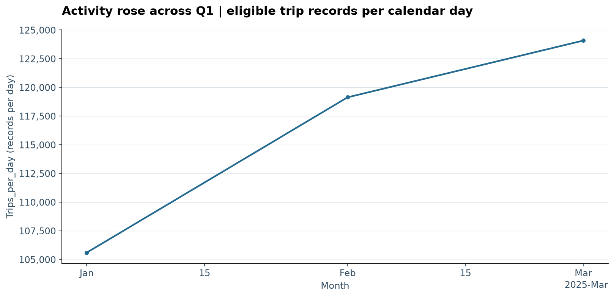
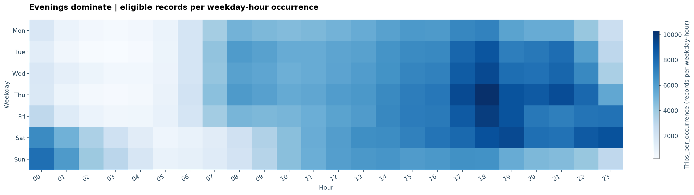
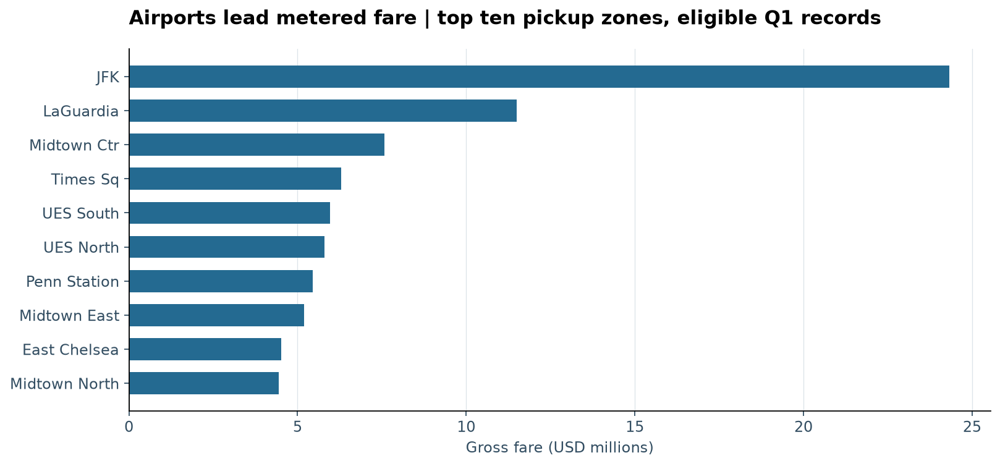
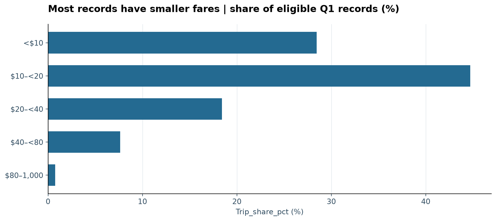
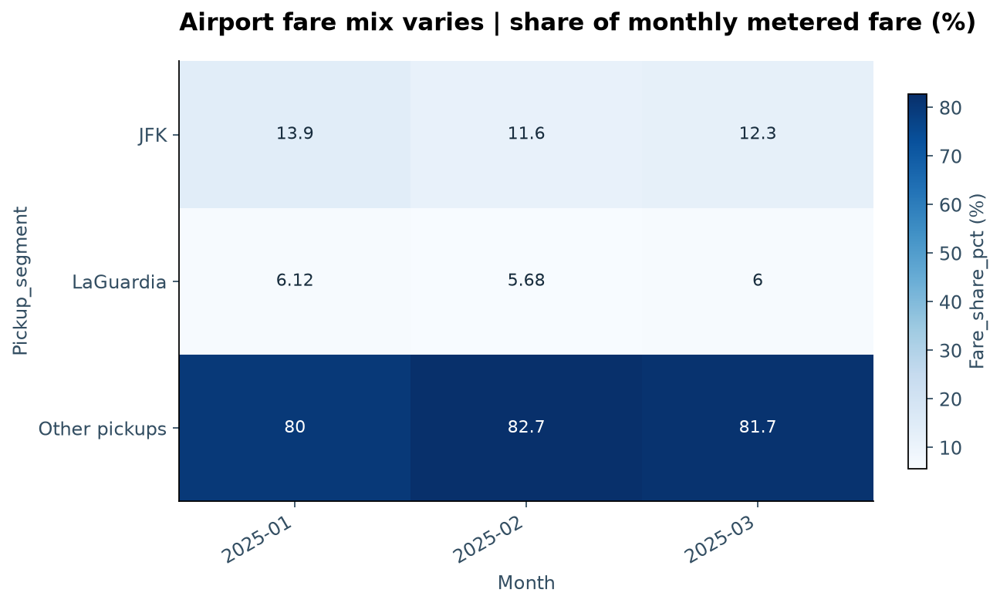

# Taxi business-analysis demonstration — 2026-11-14 UTC

**Needs revision: analysis produced, full artifact delivery failed.** INT-444 ran on
11,198,026 original NYC TLC yellow-taxi Q1 2025 rows and the official zone lookup.
This is one practical demonstration with one repair, not a resumed reliability campaign.
[Data, terms and brief](../../docs/dataset-demonstration.md).

| Attempt | Application outcome | Model calls | Duration | VM commands |
| --- | --- | ---: | ---: | ---: |
| First pass | cannot_answer; no artifacts | 17 | 480.446 s | 40 / 40 |
| One repair | failed at final export | 33 | 527.372 s | 55 / 80 |

Both used GPT-6.1 Sol through the owner's ChatGPT subscription, medium reasoning,
SmolVM1.31.1, 4 GiB/3 CPUs, read-only assigned data and no guest network. Source
`9463f7cec50ccc9e` at `84de9d7` remained unchanged. The repair used the
existing custom resource-profile API and ordinary tooling guidance about bounded
JSON evidence, numeric precision and command budgeting. No expected data answers
were supplied. Admission declared four source files and a dictionary; the runtime
also hashed a zero-byte macOS `Icon\r` metadata file. No curator profiling or oracle
was mounted. This source family was previously prepared in a different taxi slice;
training/source-family novelty is not claimed.

Total subscription usage: **50 model calls**, **1,172,396 input tokens**, **22,350 output
tokens**, about **16.8 minutes** of recorded run time. No per-request dollar charge is
reported for this route; no paid API fallback or new paid judge run occurred. Tokens
and subscription capacity are still consumed. Peak sampled VM use was about 397 MiB
(first) and 337 MiB (repair), including guest overhead; this is not >=10 GiB scale acceptance.

The first attempt recovered from a DuckDB API error, but evidence mismatch and command
exhaustion prevented rendering. The repair rendered twice, inspected five charts,
returned structured completion and performed workbook checks in the VM. The clean
publisher then failed with **`ReadError: unexpected end of data`** while exporting a
single **25-file / 24,885,509-byte** bundle. The application correctly kept failed status
and removed partial host output. HTML and XLSX have **not** been delivered or reviewed
on the host. The model's completed response does not override that application failure.
Root cause is unconfirmed; [INT-498](https://linear.app/intelip/issue/INT-498) already
tracked the same error for larger combined exports and now includes this single-report case.
Fix and verify the transfer offline using valid artifacts before any further inference.

## Three independently recomputed claims

Using fresh host SQL over raw Parquet and the lookup, with decimal currency sums:

| Claim under the declared eligibility | Recomputed | Result |
| --- | ---: | --- |
| Eligible trip records | 10,455,713 | Matches final render metric |
| Gross recorded metered fare | $193,587,031.30 | Matches final render metric |
| Airport concentration | JFK $24,330,170.25 / 12.57%; LaGuardia $11,490,575.70 / 5.94% | Matches reported shares |

Eligibility: Q1 pickup, payment codes 0/1/2, positive finite fare/charge, duration above
zero and at most 24 hours, metered fare at most $1,000. The last screen removes nine
otherwise eligible records / $58,062.58. These are reported rows, not unique vehicles
or observed unmet demand. Metered fare is not audited settlement or profit. Missing
passenger counts/distance remain; occupancy/speed claims are avoided. Local civil
time/DST, changing payment coverage and observational-policy limitations remain.
The scoped checks support these three values; they do not certify every report claim.
Portable third-check SQL is retained in [assessment.json](assessment.json); exact local
SQL/results are outside Git in `data/output/int444-taxi-20261114/`.

## Retained chart previews

These five PNGs were recovered **without model calls** from `inspect_chart` messages.
Each SHA-256 matches the last successful render manifest. They are actual retained
previews, not a reconstructed or delivered report bundle. Titles and primary comparisons
are readable. Internal column names, cluttered automatic date ticks and the airport-mix
heatmap's weak comparison of small shares fall short of the desired executive polish.
The active renderer needs that refinement; no additional visual repair was attempted.

### Monthly activity

### Weekday and hour

### Pickup-zone fares

### Fare distribution

### Airport fare mix

## Traces and stopping decision

- [First attempt](https://smith.langchain.com/o/90b24546-f3e2-4f48-af72-b06e73b27b49/projects/p/d975ee3d-b39c-4ea1-83a5-5007cd2e3be6/r/829419de-5a11-4c9c-98ee-164b9305798f?poll=true)
- [Single bounded repair](https://smith.langchain.com/o/90b24546-f3e2-4f48-af72-b06e73b27b49/projects/p/d975ee3d-b39c-4ea1-83a5-5007cd2e3be6/r/be4a2de5-a513-4e4e-bb71-23ac339581c9?poll=true)
- [Structured assessment, usage and preview hashes](assessment.json)

No third model attempt will run for this demonstration. Preserve both failures, keep
INT-444 open for usable artifact delivery, and resolve INT-498 offline. Do not restart
the frozen 63-response campaign or claim release qualification from this run.
